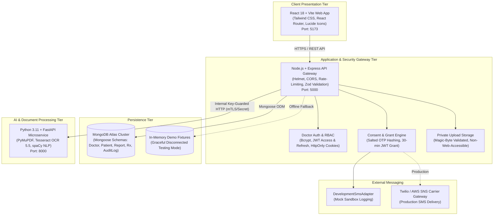

# Heterogeneous Hospital Management System (HMS)

> **B.Tech Capstone Project**  
> A multi-modal, secure Hospital Management System featuring patient OTP-consented EMR access, privacy-preserving patient search, and automated medical report OCR & NLP digitization with mandatory clinician review.

---

## 1. Project Purpose & Feature Overview

Modern electronic medical record (EMR) systems often struggle to balance clinician usability with patient data privacy and the ingestion of heterogeneous physical documents (printed lab results, scanned pathology slips, and digital PDFs). 

**Heterogeneous HMS** addresses these challenges through a three-tier decoupled architecture:
1. **Zero-Knowledge Search & Patient Authorization:** Authenticated doctors can search for patient identifiers without exposing medical history or unmasked contact details. An explicit, cryptographically secured 6-digit OTP challenge is dispatched to the patient's registered mobile number before any medical history is decrypted or transmitted.
2. **Time-Bound, Scoped Access Grants:** Successful OTP verification grants a doctor a temporary 30-minute cryptographic session grant (`PatientAccessGrant`) bound strictly to that specific patient and doctor. Grant tokens cannot be transferred between physicians or used across different patients.
3. **Automated Diagnostic OCR & NLP Pipeline:** Scanned documents and pathology reports (PDF, PNG, JPEG) uploaded by authorized clinicians are processed by a dedicated Python microservice leveraging Tesseract OCR, PyMuPDF, and spaCy NLP to identify test names, observed values, reference units, and clinical findings.
4. **Human-in-the-Loop Clinician Confirmation:** Extracted lab results are saved as *Pending Review*. Licensed clinicians must inspect the original document side-by-side with extracted metrics, make necessary corrections, and formally sign off before findings are recorded to the patient's persistent clinical history.
5. **Digital Prescription Issuance:** Doctors can prescribe medications with dosage instructions and follow-up directives tied directly to patient encounters.

---

## 2. Technology Stack & Architecture Diagram



### Technology Matrix

| Layer | Technologies & Libraries |
| :--- | :--- |
| **Frontend** | React 18, Vite 6, Tailwind CSS, React Router v6, Axios, Lucide React, Plus Jakarta Sans & Inter Typography |
| **Core Backend** | Node.js (v18+), Express.js 4, Mongoose 8, Zod, Helmet, CORS, express-rate-limit, bcryptjs, jsonwebtoken, Multer |
| **OCR Microservice** | Python 3.10+, FastAPI, Uvicorn, Tesseract OCR 5.5, pytesseract, PyMuPDF (fitz), Pillow, spaCy (`en_core_web_sm`) |
| **Persistence** | MongoDB Atlas (M0/M10+), Local Memory Store Fallback for resilient zero-dependency testing |

---

## 3. Repository Folder Structure

```
heterogeneous-hms/
├── .gitignore                          # Root ignore file (excludes node_modules, venv, .env, uploads)
├── .env.example                        # Root pointer documentation for subsystem environment files
├── README.md                           # Master developer handoff and deployment guide
│
├── frontend/                           # React 18 Vite Single Page Application
│   ├── .env.example                    # Frontend environment configuration template
│   ├── index.html                      # Single-page HTML entry point
│   ├── package.json                    # Frontend dependencies and npm scripts
│   ├── vite.config.js                  # Vite bundler configuration
│   ├── tailwind.config.js              # Tailwind design tokens and palette
│   └── src/
│       ├── App.jsx                     # Route declarations and root providers
│       ├── main.jsx                    # React DOM entry point
│       ├── index.css                   # Global styles and typography
│       ├── components/                 # Reusable UI components (Sidebar, Navbar, StatusBadge, Cards)
│       ├── layouts/                    # AppLayout (Doctor sidebar + header), AuthLayout
│       ├── pages/                      # LoginPage, DashboardPage, PatientSearchPage, 
│       │                               # PatientVerifyPage, PatientHistoryPage, PatientReportsPage,
│       │                               # PatientReportUploadPage, PatientReportDetailPage,
│       │                               # PatientPrescriptionsPage, PatientPrescriptionNewPage
│       ├── hooks/                      # useAuth, custom state management hooks
│       └── services/                   # api.js (Axios instance with auto-injected Bearer & Grant tokens)
│
├── backend/                            # Node.js Express Core Gateway
│   ├── .env.example                    # Backend environment template (MongoDB, JWT, Twilio placeholders)
│   ├── package.json                    # Backend dependencies and native node:test scripts
│   ├── server.js                       # Express app bootstrap, CORS, Helmet, and server startup
│   ├── config/                         # db.js (MongoDB Atlas connection with graceful fallback)
│   ├── controllers/                    # authController, patientController, reportController, prescriptionController
│   ├── middleware/                     # authMiddleware, grantMiddleware, uploadMiddleware, rateLimiter, validate
│   ├── models/                         # Doctor, Patient, MedicalReport, Prescription, OTPChallenge, AuditLog
│   ├── routes/                         # authRoutes, patientRoutes, healthRoutes
│   ├── services/                       # authService, patientService, otpService, reportService, prescriptionService
│   │   ├── ocr/                        # pythonOcrService.js (HTTP client for FastAPI microservice)
│   │   └── sms/                        # smsProviderFactory.js, DevelopmentSmsAdapter.js, TwilioSmsAdapter.js
│   ├── storage/uploads/private/        # Secure document store outside public web root
│   ├── validators/                     # patientValidators.js, clinicalValidators.js (Zod schemas)
│   ├── scripts/                        # seed.js (Safe, idempotent demonstration database populator)
│   └── tests/                          # 6 automated test suites (auth, health, integration_e2e, otp, security, validation)
│
└── ocr-service/                        # Python FastAPI OCR & NLP Microservice
    ├── .env.example                    # Microservice environment template (Tesseract path, limits)
    ├── requirements.txt                # Python package dependencies
    ├── app/
    │   ├── main.py                     # FastAPI application entry, CORS, and middleware
    │   ├── config.py                   # Pydantic BaseSettings for environment variable loading
    │   ├── routes/                     # health.py, ocr.py
    │   ├── services/                   # document_parser.py (PyMuPDF & Tesseract), nlp_extractor.py (spaCy)
    │   └── utils/                      # security.py (X-Internal-Service-Key verification), magic_bytes.py
    └── tests/                          # test_health.py, test_ocr_pipeline.py (unittest suite)
```

---

## 4. Prerequisites for Windows 11

Ensure the following tools are installed on your Windows 11 workstation:

1. **Operating System:** Windows 11 (64-bit).
2. **Node.js & npm:** Node.js v18.x or v20.x LTS with npm v9+. Verify via `node -v` and `npm -v`.
3. **Python:** Python 3.10 or 3.11 (64-bit). Verify via `python --version`. *(Check "Add python.exe to PATH" during installation)*.
4. **Tesseract OCR:** Tesseract v5.x binary for Windows.
5. **Shell:** Windows PowerShell 7 or Windows Terminal (PowerShell 5.1+ supported).
6. **MongoDB Atlas Account:** A free M0 cluster or local MongoDB instance (optional for unit tests, required for persistent data).

---

## 5. Tesseract Installation & Windows PATH Setup

1. **Download the Windows Installer:**  
   Download the official 64-bit installer from the UB Mannheim repository:  
   `https://github.com/UB-Mannheim/tesseract/wiki`
2. **Standard Installation Path:**  
   Install to the standard directory:  
   `C:\Program Files\Tesseract-OCR`
3. **Verify Executable Path:**  
   Confirm `tesseract.exe` exists by running in PowerShell:
   ```powershell
   & "C:\Program Files\Tesseract-OCR\tesseract.exe" --version
   ```
4. **Add to Windows System Environment Variables:**
   - Press <kbd>Win</kbd> + <kbd>R</kbd>, type `sysdm.cpl`, press <kbd>Enter</kbd>.
   - Switch to the **Advanced** tab and click **Environment Variables**.
   - Under **System Variables**, select `Path` and click **Edit**.
   - Click **New** and add: `C:\Program Files\Tesseract-OCR`.
   - Click **OK** to save.
5. **Verify Command in a Fresh Terminal:**
   ```powershell
   tesseract --version
   ```

---

## 6. Python Virtual Environment Setup (`ocr-service`)

Open a PowerShell terminal and initialize the Python virtual environment:

```powershell
# 1. Navigate to ocr-service
cd ocr-service

# 2. Create virtual environment
python -m venv venv

# 3. Allow script execution in current PowerShell session if restricted
Set-ExecutionPolicy -Scope Process -ExecutionPolicy Bypass

# 4. Activate virtual environment
.\venv\Scripts\Activate.ps1

# 5. Upgrade pip
python -m pip install --upgrade pip

# 6. Install dependencies
pip install -r requirements.txt

# 7. Download the spaCy English NLP model
python -m spacy download en_core_web_sm

# 8. Copy environment template
Copy-Item .env.example .env

# 9. Verify microservice test suite (10/10 tests should pass)
python -m unittest discover tests -v
```

---

## 7. Node.js Backend & Frontend Dependency Installation

### Backend Setup:
```powershell
cd backend
Copy-Item .env.example .env
npm install
```

### Frontend Setup:
```powershell
cd frontend
Copy-Item .env.example .env
npm install
```

---

## 8. MongoDB Atlas Cluster & Network Access Configuration

To connect a persistent MongoDB Atlas cluster:

1. **Create Free M0 Cluster:** Sign in to [MongoDB Atlas](https://cloud.mongodb.com/) and create a free Shared M0 cluster in your nearest region.
2. **Create Database User:**
   - Navigate to **Security** &rarr; **Database Access**.
   - Click **Add New Database User**.
   - Select **Password Authentication**. Set Username (e.g., `hms_doctor_admin`) and a secure password.
   - Assign user privileges: **Read and write to any database**.
3. **Configure Network Access (IP Whitelist):**
   - Navigate to **Security** &rarr; **Network Access**.
   - Click **Add IP Address**.
   - For local development, click **Add Current IP Address** or use `0.0.0.0/0` (Allow Access from Anywhere) with a reminder to restrict it prior to production.
4. **Obtain Connection String:**
   - Under **Deployments** &rarr; **Database**, click **Connect**.
   - Select **Drivers** &rarr; **Node.js**.
   - Copy the URI and paste into `backend/.env`:
     ```ini
     MONGODB_URI=mongodb+srv://hms_doctor_admin:<password>@cluster0.yourid.mongodb.net/heterogeneous_hms?retryWrites=true&w=majority
     ```

> [!NOTE]  
> If `MONGODB_URI` is left blank, the backend automatically operates in **Disconnected Graceful Fallback Mode**, utilizing built-in in-memory demonstration records for all endpoints and automated test suites.

---

## 9. Environment Variables Configuration

Create `.env` from `.env.example` in all three directories:

### `backend/.env`
```ini
PORT=5000
NODE_ENV=development
FRONTEND_URL=http://localhost:5173

# Database (Leave empty for in-memory demo mode)
MONGODB_URI=mongodb+srv://<username>:<password>@<cluster>.mongodb.net/heterogeneous_hms?retryWrites=true&w=majority

# Python OCR Microservice binding
OCR_SERVICE_URL=http://127.0.0.1:8000
OCR_SERVICE_SECRET=dev_internal_ocr_secret_2026
OCR_REQUEST_TIMEOUT_MS=30000

# Authentication & Cryptographic Salt
JWT_SECRET=demo_insecure_jwt_secret_key_change_in_production_min32
JWT_REFRESH_SECRET=demo_insecure_jwt_refresh_secret_key_change_in_production_min32
JWT_ACCESS_EXPIRES_IN=15m
JWT_REFRESH_EXPIRES_IN=7d
OTP_SECRET_SALT=demo_otp_secret_salt_value_for_local_development

# SMS Provider ('mock' for local sandbox; 'twilio' for real mobile delivery)
SMS_PROVIDER=mock
DEV_FIXED_OTP=482731
```

### `ocr-service/.env`
```ini
HOST=127.0.0.1
PORT=8000
ENVIRONMENT=development
TESSERACT_CMD=C:\Program Files\Tesseract-OCR\tesseract.exe
OCR_SERVICE_SECRET=dev_internal_ocr_secret_2026
MAX_FILE_SIZE_BYTES=15728640
MAX_PAGES_LIMIT=10
SPACY_MODEL=en_core_web_sm
ALLOWED_ORIGINS=http://localhost:5173,http://127.0.0.1:5173,http://localhost:5000,http://127.0.0.1:5000
```

### `frontend/.env`
```ini
VITE_API_BASE_URL=http://localhost:5000/api
VITE_OCR_SERVICE_URL=http://127.0.0.1:8000/api/v1
```

---

## 10. Starting All Services in VS Code Terminals

Open three separate PowerShell terminal tabs in VS Code (<kbd>Ctrl</kbd> + <kbd>Shift</kbd> + <kbd>`</kbd>):

### Terminal 1: Core Node.js Backend (Port 5000)
```powershell
cd backend
npm run dev
```
*Expected Output:*
```
[Database] Connected successfully to MongoDB Atlas: heterogeneous_hms
[Server] Heterogeneous HMS Core Gateway running on port 5000
[Server] Environment: development | CORS whitelisted: http://localhost:5173
```

### Terminal 2: React Vite Frontend (Port 5173)
```powershell
cd frontend
npm run dev
```
*Expected Output:*
```
  VITE v6.4.5  ready in 420 ms

  ➜  Local:   http://localhost:5173/
  ➜  Network: use --host to expose
```

### Terminal 3: Python OCR Microservice (Port 8000)
```powershell
cd ocr-service
.\venv\Scripts\Activate.ps1
uvicorn app.main:app --host 127.0.0.1 --port 8000 --reload
```
*Expected Output:*
```
[Tesseract] Detected Windows binary at C:\Program Files\Tesseract-OCR\tesseract.exe
[NLP] spaCy model 'en_core_web_sm' loaded successfully.
INFO:     Uvicorn running on http://127.0.0.1:8000 (Press CTRL+C to quit)
```

---

## 11. Local URLs & Health-Check Endpoints

| Service | Interface / Endpoint | URL | Expected Response |
| :--- | :--- | :--- | :--- |
| **Frontend Web App** | Doctor Login & Dashboard | `http://localhost:5173` | React Login Screen |
| **Backend Health** | System & Database Status | `http://localhost:5000/health` | `{"status":"OK","database":"connected",...}` |
| **Backend API Health**| Gateway Telemetry Alias | `http://localhost:5000/api/health` | `{"status":"OK","database":"connected",...}` |
| **OCR Service Health**| OCR & Tesseract Readiness | `http://127.0.0.1:8000/health` | `{"status":"healthy","tesseract_available":true}` |
| **OCR Swagger Docs**  | Interactive API Explorer | `http://127.0.0.1:8000/docs` | FastAPI Swagger OpenAPI UI |

---

## 12. Safe Demonstration Data Population

To populate realistic, fictional demonstration records into MongoDB Atlas without risk to existing data:

```powershell
cd backend
npm run seed
# Or directly:
node scripts/seed.js --run
```

*Data Safety Guarantee:*  
The seed script utilizes atomic MongoDB upserts with `$setOnInsert`. It **never deletes, drops, or overwrites** existing records.

### Fictional Demonstration Credentials

- **Doctor Login:**  
  - Doctor ID: `DOC-108` or Email: `doctor@hospital.com`  
  - Password: `Password123!`
- **Demo Patients:**  
  - `PID-2026-1234` (Rahul Sharma, 32M, Contact: `+91 98765-XXXXX`)
  - `PID-2026-5678` (Priya Patel, 28F, Contact: `+91 98210-XXXXX`)
  - `PID-2026-9012` (Amit Verma, 45M, Contact: `+91 97112-XXXXX`)
- **Development OTP Verification Code:** `482731` (or inspect Terminal 1 console for the logged simulated SMS dispatch).

---

## 13. End-to-End Walkthrough of the Clinical Workflow

1. **Doctor Authentication:**
   - Open `http://localhost:5173`.
   - Log in with `doctor@hospital.com` and `Password123!`.
   - The doctor overview dashboard appears with active sessions and patient quick-actions.
2. **Patient Lookup:**
   - Click **Find Patient** in the sidebar or top bar.
   - Enter `PID-2026-1234`.
   - Notice that **zero clinical history** is displayed. Only the patient's name and masked mobile number (`+91 98765-XXXXX`) are revealed.
3. **Patient OTP Verification:**
   - Click **Send OTP Challenge**.
   - Check Terminal 1 logs to observe the simulated SMS dispatch notice.
   - Enter `482731` and submit.
   - A short-lived, cryptographically signed `PatientAccessGrant` is issued and stored in memory.
4. **Clinical History Access:**
   - The browser navigates automatically to `/patients/PID-2026-1234/history`.
   - Authorized chronic conditions (Diabetes, Hypertension), allergies, prior visits, lab reports, and prescriptions are displayed.
5. **Report Upload & OCR Extraction:**
   - Click **Upload Report** (`/patients/PID-2026-1234/reports/upload`).
   - Select a sample PDF or PNG laboratory report.
   - Click **Upload & Process Document**. The document is saved to private storage, and the OCR microservice parses structured parameters (`Hemoglobin`, `Platelets`, `Creatinine`, etc.).
6. **Clinician Review & Confirmation:**
   - An interactive review table displays extracted metrics with status indicators (*Normal*, *High*, *Low*).
   - As a licensed doctor, edit any uncertain observed value or reference range.
   - Click **Confirm & Save to Clinical Records**. Status transitions to `REVIEWED`.
7. **Issuing a Digital Prescription:**
   - Click **New Prescription** (`/patients/PID-2026-1234/prescriptions/new`).
   - Enter medication details (e.g. *Ferrous Ascorbate 100mg*, *Once daily after dinner*, *30 days*).
   - Click **Issue & Sign Prescription**. It is added to the patient's persistent record.
8. **Grant Revocation:**
   - Click **Revoke Access** on the patient banner. Access is terminated immediately, preventing further history inspection without a new patient OTP challenge.

---

## 14. OCR/NLP Limitations & Mandatory Clinician Review

> [!WARNING]  
> **Medical Decision-Making Safeguard:**  
> The Python OCR/NLP microservice is designed as a **clinical documentation accelerator**, NOT an autonomous diagnostic tool.

### Known Technical Limitations:
1. **Document Artifacts:** Low-resolution camera scans, motion blur, non-standard font ligatures, or skewed angles may degrade OCR character recognition.
2. **Handwritten Prescriptions:** Tesseract OCR is trained primarily on printed typeface; freeform handwriting requires clinician transcription.
3. **Complex Tables:** Multi-column laboratory formats with non-standard dividers may occasionally misalign headers and values.
4. **Safety Filter:** The microservice refuses to hallucinate missing values. Tests below acceptable confidence thresholds are marked *Uncertain* with low confidence flags.

**Mandatory Workflow Rule:**  
Every diagnostic report remains in `PENDING_REVIEW` status until a licensed clinician visually compares the extracted numbers against the embedded document preview and clicks **Confirm Review**.

---

## 15. Common Windows Setup Errors & Troubleshooting

| Error | Root Cause | Solution |
| :--- | :--- | :--- |
| `File ... cannot be loaded because running scripts is disabled on this system.` | PowerShell execution policy restricts running `Activate.ps1`. | Run in PowerShell: `Set-ExecutionPolicy -Scope Process -ExecutionPolicy Bypass` |
| `TesseractNotFoundError: tesseract is not installed or it's not in your PATH` | Tesseract binary is missing from PATH or installed in custom path. | Set `TESSERACT_CMD=C:\Program Files\Tesseract-OCR\tesseract.exe` in `ocr-service/.env`. |
| `[MongoDB] connection error: querySrv ENOTFOUND` or timeout | MongoDB Atlas IP access list does not allow connection from current IP. | Add current public IP address under Atlas **Security** &rarr; **Network Access**. |
| `Error: listen EADDRINUSE: address already in use :::5000` | Port 5000 is occupied by an orphaned Node or background process. | Run: `Get-Process -Id (Get-NetTCPConnection -LocalPort 5000).OwningProcess \| Stop-Process -Force` |
| `ModuleNotFoundError: No module named 'spacy'` in OCR service | Dependencies were installed outside active virtual environment. | Ensure `.\venv\Scripts\Activate.ps1` was executed prior to running `pip install -r requirements.txt`. |
| `spaCy model 'en_core_web_sm' not found` | The English language pack was not downloaded. | Run: `python -m spacy download en_core_web_sm` within the activated virtual environment. |

---

## 16. Service Dependency Requirements Matrix

| Service / Dependency | Role | Is It Required? | Fallback Behavior When Unconfigured |
| :--- | :--- | :---: | :--- |
| **Node.js Core Backend** | API Gateway, Auth, Grants | **REQUIRED** | System cannot function without core gateway. |
| **React Vite Frontend** | Clinician Web Interface | **REQUIRED** | System cannot function without UI. |
| **Python OCR Microservice** | Automated Document Digitization | **REQUIRED FOR OCR** | If offline, report uploads succeed and store the raw file safely, while OCR extraction falls back to a simulated pending review placeholder. |
| **MongoDB Atlas** | Persistent Multi-Tenant Storage | **OPTIONAL FOR LOCAL DEV** | If `MONGODB_URI` is unset, backend automatically switches to in-memory fixtures for seamless local evaluation and testing. |
| **SMS Gateway (Twilio)** | Real Patient Mobile Delivery | **OPTIONAL FOR LOCAL DEV** | Defaults to `mock` (`DevelopmentSmsAdapter`), which safely logs masked delivery to the terminal. |

---

## 17. Feature Status Matrix

| Component | Feature | Implementation Status | Test Coverage |
| :--- | :--- | :---: | :---: |
| **Auth** | Doctor Email / ID Login & Logout | **Implemented** | 11/11 tests passing (`auth.test.js`) |
| **Auth** | Bcrypt Password Hashing & Rate Limiting | **Implemented** | Verified (HTTP 429 after 5 failed attempts) |
| **Consent** | Privacy-Preserving Patient Search | **Implemented** | Verified (Zero PII / zero clinical history returned) |
| **Consent** | Salted OTP Challenge & Resend Cooldown | **Implemented** | Verified (60-second cooldown enforced) |
| **Consent** | Single-Use OTP Verification & Brute-Force Lock | **Implemented** | Verified (3 attempts max; replay rejected) |
| **Access** | Scoped 30-min `PatientAccessGrant` JWT | **Implemented** | 12/12 tests passing (`security_access_control.test.js`) |
| **Access** | Cross-Patient & Cross-Doctor Tamper Rejection | **Implemented** | Verified (HTTP 403 `GRANT_MISMATCH`) |
| **Access** | Immediate Grant Revocation | **Implemented** | Verified (HTTP 403 `GRANT_REVOKED`) |
| **Clinical** | Patient History, Labs, & Prescriptions API | **Implemented** | 14/14 tests passing (`integration_e2e.test.js`) |
| **Clinical** | Digital Prescription Creation & History | **Implemented** | Verified with Zod schema validation |
| **Files** | Magic-Byte Inspection (Disguised PDF Rejection) | **Implemented** | Verified (HTTP 400 `INVALID_FILE_SIGNATURE`) |
| **Files** | Isolated Storage Outside Public Web Root | **Implemented** | Verified (`backend/storage/uploads/private/`) |
| **OCR** | PyMuPDF Text Extraction & Tesseract OCR | **Implemented** | 10/10 tests passing (`test_ocr_pipeline.py`) |
| **OCR** | spaCy NLP Finding & Parameter Extraction | **Implemented** | Verified on laboratory panel reports |
| **OCR** | Shared Secret Backend-to-Microservice Auth | **Implemented** | Verified (HTTP 401 when key omitted) |
| **Review** | Clinician Parameter Editing & Review Confirmation | **Implemented** | Verified (`PATCH /:pid/reports/:reportId/review`) |
| **Frontend** | Complete Multi-Page Clinical Workflow UI | **Implemented** | Production build verified (`dist/`, 1,661 modules) |
| **SMS Carrier**| Twilio / AWS SNS Real Carrier Dispatch | **Partially Configured** | Mock adapter verified; Twilio adapter ready for credentials |

---

## 18. Security Limitations & Pre-Production Checklist

Before deploying Heterogeneous HMS to a public, production medical environment, complete the following hardening steps:

1. **Replace Mock SMS Gateway:**
   - Configure a verified healthcare SMS provider (e.g. Twilio with 10DLC registration or AWS SNS).
   - Set `SMS_PROVIDER=twilio` in `backend/.env` with your real `TWILIO_ACCOUNT_SID`, `TWILIO_AUTH_TOKEN`, and `TWILIO_PHONE_NUMBER`.
2. **Enforce HTTPS / TLS Termination:**
   - Deploy behind an enterprise reverse proxy (Nginx, Cloudflare, or AWS ALB) with SSL/TLS certificates.
   - This ensures `secure: true` session cookies transmit exclusively over HTTPS.
3. **Production Cryptographic Secrets:**
   - Generate cryptographically strong (minimum 256-bit) random strings for `JWT_SECRET`, `JWT_REFRESH_SECRET`, `OTP_SECRET_SALT`, and `OCR_SERVICE_SECRET`.
   - Never use development placeholders in staging or production.
4. **Private Subnet Isolation for OCR Microservice:**
   - Deploy `ocr-service` within a private VPC subnet accessible only from the Node.js backend cluster, without exposing port 8000 to the public internet.
5. **Encrypted Cloud Object Storage:**
   - Transition `backend/storage/uploads/private/` to an enterprise encrypted bucket (e.g., AWS S3 with KMS or Google Cloud Storage) with signed temporary URLs.
6. **Persistent MongoDB Atlas Cluster:**
   - Ensure `MONGODB_URI` connects to a dedicated production replica set with IP whitelist restricted strictly to backend application servers.
